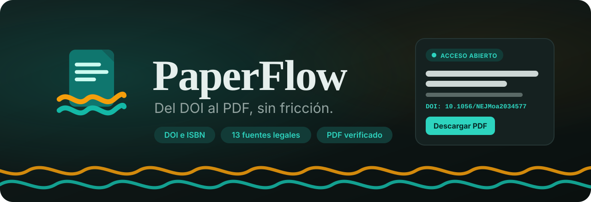
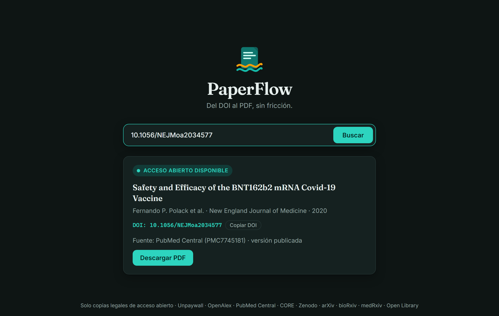
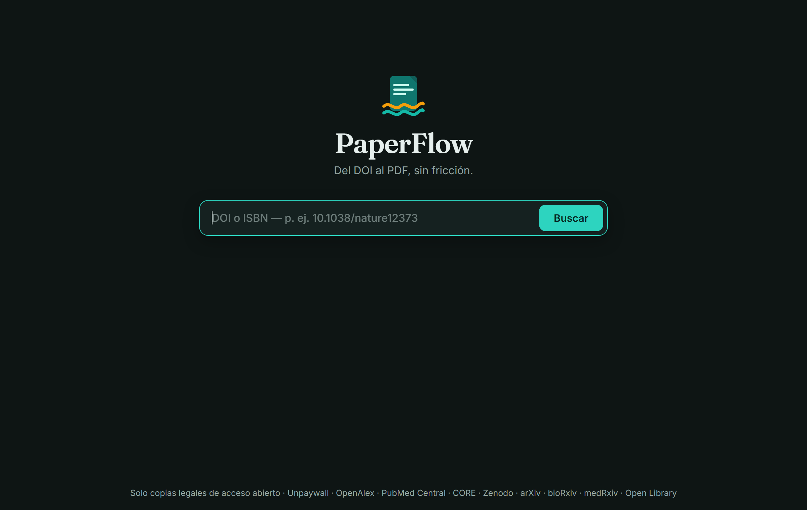
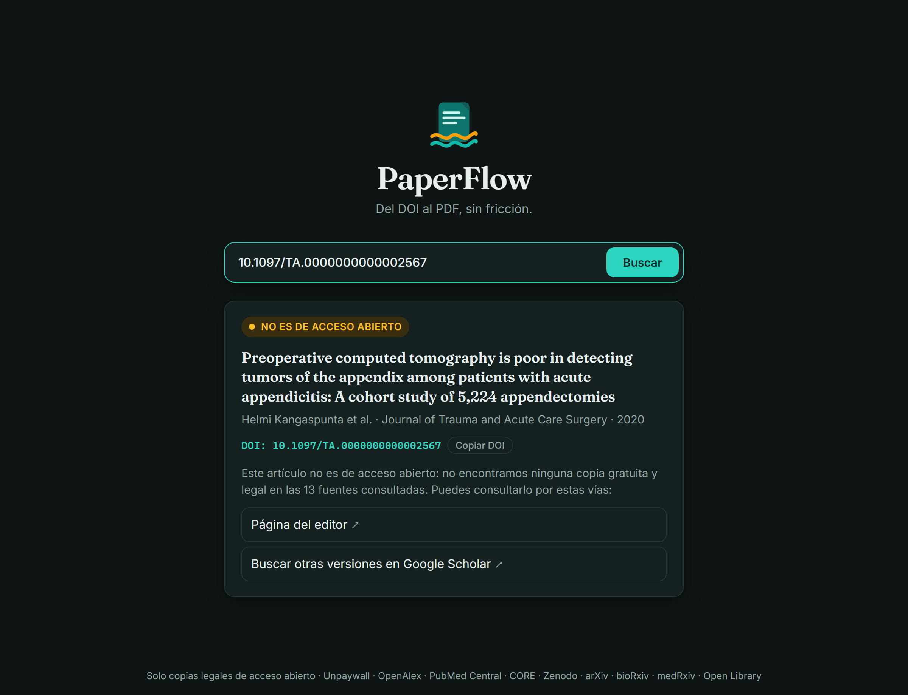
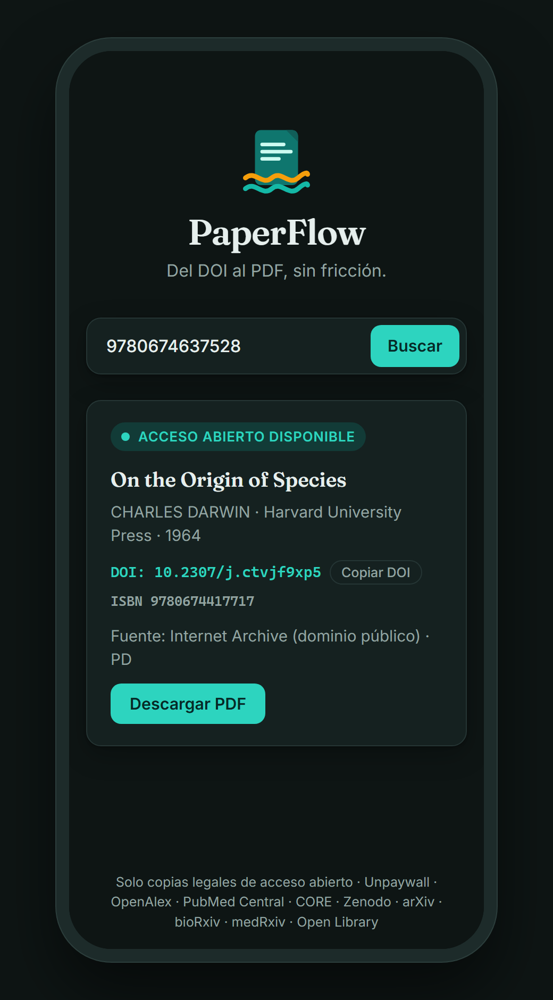
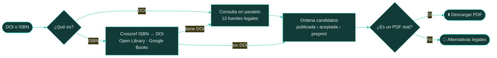

<p align="center">
  
</p>

<p align="center">
  
  
  
  
  
</p>

<p align="center">
  <b>Escribe un DOI o un ISBN y PaperFlow encuentra una copia <i>legal</i> de acceso abierto,<br>
  comprueba que sea un PDF real y te la entrega con un clic.</b>
</p>

---

## ✨ Características

- 🔎 **Una sola caja de búsqueda**: acepta DOI (`10.xxxx/...`, `doi:...`, `https://doi.org/...`) e ISBN-10/13.
- ⚡ **13 fuentes consultadas en paralelo**: la respuesta suele llegar en 3 a 7 segundos.
- 🏛️ **Prioriza la versión publicada**: primero la del editor, luego el manuscrito aceptado y al final el preprint.
- ✅ **PDF verificado**: antes de ofrecerlo comprueba que el archivo empiece con `%PDF-`, no una página de error.
- 📚 **Libros**: convierte ISBN en DOI y busca ediciones de dominio público en Open Library / Internet Archive.
- 🧭 **Alternativas legales** cuando no hay acceso abierto: editor, repositorios, bibliotecas cercanas (WorldCat), tu biblioteca institucional y Google Scholar.
- 🌗 **Modo claro y oscuro** automático, diseño adaptable a móvil y respeto de "reducir movimiento".
- 🛡️ **Seguro por diseño**: protección SSRF en cada redirección y descargas solo de URLs verificadas por el servidor.

## 📸 Capturas

<p align="center">
  
</p>

<table>
  <tr>
    <td align="center" width="38%"><br><sub><b>Inicio minimalista</b></sub></td>
    <td align="center" width="38%"><br><sub><b>Sin acceso abierto: alternativas legales</b></sub></td>
    <td align="center" width="24%"><br><sub><b>Móvil · libro por ISBN</b></sub></td>
  </tr>
</table>

## 🗂️ Fuentes

| | Fuente | Qué aporta |
|:-:|---|---|
| 🏢 | **Página del editor** | Lee la etiqueta `citation_pdf_url` de artículos de acceso libre (PLOS, Nature, Frontiers, MDPI…) |
| 🧬 | **PubMed Central** | Colección abierta de NCBI, vía AWS Open Data |
| 🔓 | **Unpaywall** | El mayor índice de copias abiertas (requiere `PAPERFLOW_EMAIL`) |
| 🌐 | **OpenAlex** | Repositorios institucionales y libros OAPEN |
| 🎓 | **CORE** | Agregador de repositorios universitarios |
| 🗄️ | **Zenodo** | Depósitos de autores (solo si el registro *es* el mismo trabajo, no si solo lo cita) |
| 🧪 | **bioRxiv / medRxiv** | Preprints, incluido el preprint de un artículo ya publicado |
| 📐 | **arXiv · Semantic Scholar** | Preprints y `openAccessPdf` |
| 🏷️ | **Crossref · Europe PMC** | Metadatos, licencias y detección de acceso abierto |
| 📖 | **Open Library · Internet Archive** | Libros de **dominio público** |
| 🔤 | **Google Books** | Metadatos de libros |

> [!NOTE]
> OAPEN y DOAB bloquean las consultas directas a su API desde algunas redes; sus libros igual aparecen a través de OpenAlex y Unpaywall.

## ⚙️ Cómo funciona



## 🚀 Instalación

**Requisitos:** Python 3.10 o superior.

```bash
git clone https://github.com/DaVmZ86/PaperFlow.git
cd PaperFlow
python -m venv .venv
```

```bash
# Windows
.venv\Scripts\pip install -r requirements.txt
copy .env.example .env

# macOS / Linux
.venv/bin/pip install -r requirements.txt
cp .env.example .env
```

Edita `.env`, escribe tu correo en `PAPERFLOW_EMAIL` y arranca:

```bash
# Windows
.\run.ps1

# macOS / Linux
.venv/bin/uvicorn app:app --host 127.0.0.1 --port 8000
```

Abre **http://localhost:8000** 🎉

> [!TIP]
> Puedes compartir búsquedas con un enlace directo: `http://localhost:8000/?q=10.1001/jama.2016.0287` o `?q=9780674637528`.

## 🔧 Configuración

| Variable | Para qué sirve |
|---|---|
| `PAPERFLOW_EMAIL` | 📧 Activa Unpaywall y la cola prioritaria de OpenAlex y NCBI. **Muy recomendado.** |
| `PAPERFLOW_LIBRARY_PROXY` | 🏛️ Prefijo EZproxy de tu institución (activa el botón "Acceso por mi biblioteca"). |
| `PAPERFLOW_CORE_KEY` | 🔑 Clave gratuita de [CORE](https://core.ac.uk/services/api) para más consultas por minuto (opcional). |
| `PAPERFLOW_MAX_MB` | 📦 Tamaño máximo de PDF (200 MB por defecto). |

## 🧩 API

| Método | Ruta | Descripción |
|---|---|---|
| `GET` | `/api/resolve?q=<DOI o ISBN>` | Metadatos, disponibilidad, fuente y alternativas en JSON |
| `GET` | `/api/download?q=<DOI o ISBN>` | El PDF verificado, con un nombre de archivo legible |

<details>
<summary>Ejemplo de respuesta de <code>/api/resolve</code></summary>

```json
{
  "query_kind": "doi",
  "doi": "10.1056/NEJMoa2034577",
  "isbn": null,
  "meta": {
    "title": "Safety and Efficacy of the BNT162b2 mRNA Covid-19 Vaccine",
    "authors": ["Fernando P. Polack", "..."],
    "journal": "New England Journal of Medicine",
    "year": 2020
  },
  "available": true,
  "is_oa": true,
  "source": { "name": "PubMed Central (PMC7745181)", "version": "publishedVersion", "license": "" },
  "download_url": "/api/download?q=10.1056%2FNEJMoa2034577",
  "filename": "Polack_2020_Safety_and_Efficacy_of_the_BNT162b2_mRNA_Covid-19.pdf",
  "alternatives": [{ "label": "Página del editor", "url": "https://doi.org/10.1056/NEJMoa2034577" }]
}
```

</details>

## 🛡️ Seguridad

- 🔒 El servidor solo descarga URLs que él mismo obtuvo de las fuentes, **nunca** una URL enviada por el usuario.
- 🚧 Cada petición, incluidas las redirecciones, se bloquea si apunta a una dirección privada o local (protección SSRF).
- 🧾 Antes de servir un archivo, confirma que empieza con `%PDF-`.
- ⏱️ Los resultados se guardan en caché 1 hora; si no hubo PDF, solo 10 minutos, para reintentar repositorios lentos.
- 🤫 `.env` está en `.gitignore`: tu correo y tus claves nunca se suben al repositorio.

## 📁 Estructura

```
PaperFlow/
├── app.py              # Backend FastAPI: fuentes, verificación y descarga
├── static/
│   ├── index.html      # Interfaz
│   ├── app.js          # Lógica del cliente
│   ├── styles.css      # Estilos (modo claro/oscuro)
│   └── logo.svg        # Logo
├── docs/               # Portada y capturas del README
├── requirements.txt
├── run.ps1             # Arranque rápido en Windows
└── .env.example        # Plantilla de configuración
```

---

<p align="center">
  <br>
  <sub><b>PaperFlow</b> · Solo copias legales de acceso abierto</sub>
</p>
